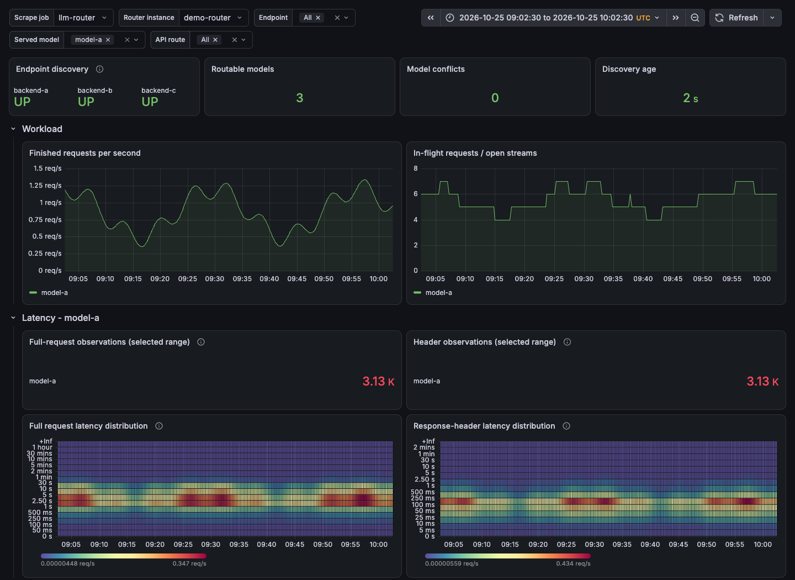
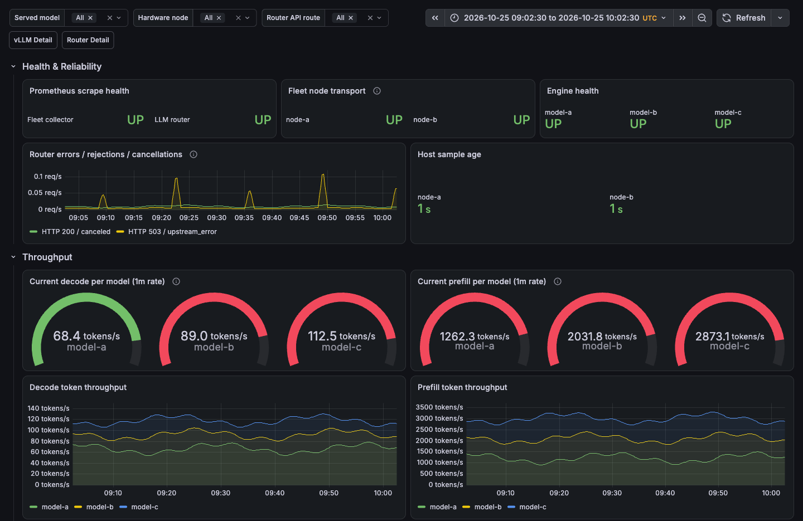

# LLM Router

Use one API address for several model servers.
The router reads each server's model list and sends requests to the matching server.

- Works with vLLM, TensorFold and LM Studio.
- Keeps model names and request bodies unchanged.
- Supports streaming, chat completions, completions, responses and embeddings.
- Rejects duplicate model IDs instead of choosing a server.
- Returns errors in the OpenAI error format.

## Quick start

You need Go 1.23 or newer.

```sh
git clone https://github.com/awlx/llm-router.git
cd llm-router
go build -trimpath -o llm-router .
cp config.example.json router.json
```

Edit `router.json`. Replace the example addresses with your server addresses,
such as `http://127.0.0.1:8000`. Do not add `/v1` to these addresses.

```sh
LLM_ROUTER_CONFIG=./router.json ./llm-router
```

Set your client's base URL to `http://127.0.0.1:1234/v1`.
Use a model ID from `GET /v1/models`.
`GET /v1/models/{id}` returns one model.

## Docker demo

Try the router with two mock servers. No GPU or model download is needed.

```sh
docker compose -f docker-compose.test.yml up --build -d
# Wait a few seconds for model discovery.
curl -q -fsS http://127.0.0.1:18235/v1/models
docker compose -f docker-compose.test.yml down
```

For HTTPS, use the [Traefik example with Let's Encrypt and Hetzner DNS](examples/traefik).

## Limits and access

- No load balancing, failover or audio routes.
- No built-in authentication or TLS. Keep the router on loopback, or put an
  authenticated TLS proxy in front of all routes.
- Logs include client IPs and model IDs. Health errors can include server addresses.

## Monitoring

Use `/health` for discovery status and `/metrics` for Prometheus metrics.
Metrics cover requests, errors, active streams, duration and body sizes.

Import the [router dashboard](docs/grafana-dashboard.json) into Grafana.
The optional [fleet overview](docs/grafana-overview.json) also needs
[vLLM Fleet Dashboard](https://github.com/awlx/vllm-dashboard).

Example dashboards with sample data:





## Tests

Dashboard tests need Node.js 22 or newer.

```sh
go test -race ./...
go vet ./...
node --test docs/refine-dashboards.test.mjs
```

## License

[MIT](LICENSE).
